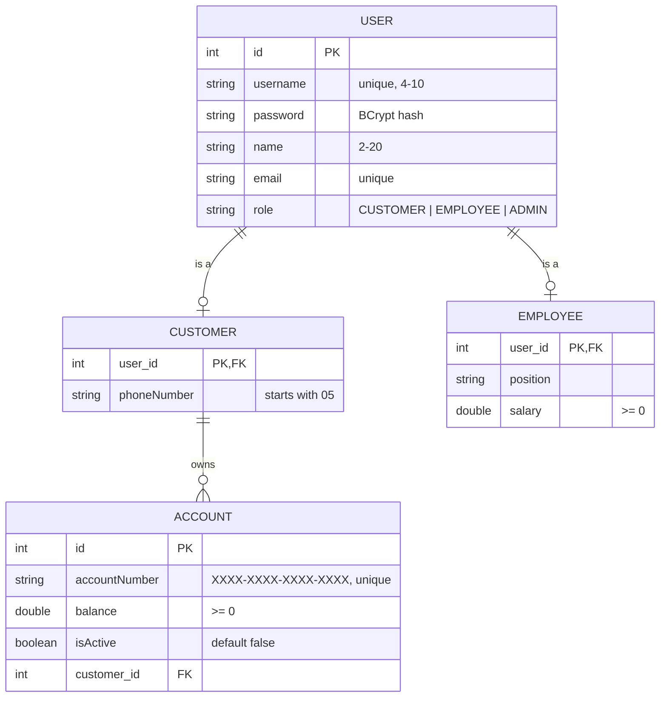

<div align="center">

# 🏦 Bank Management System

### Spring Boot REST API for managing customers, employees and bank accounts


**Tuwaiq Academy — Java Spring Boot Bootcamp · Project 3**

</div>

---

## 📖 Overview

The **Bank Management System** is a web-based backend application that lets customers manage their bank accounts and perform financial transactions, while employees and admins supervise accounts and users.

Every endpoint is protected with **role-based authorization** using Spring Security (HTTP Basic), and all money operations go through strict business rules.

---

## ✨ Features

| | Feature |
|---|---|
| 🔐 | HTTP Basic authentication with BCrypt-hashed passwords |
| 👥 | Three roles: `CUSTOMER`, `EMPLOYEE`, `ADMIN`, with authorization on **every** endpoint |
| 📝 | Customer self-registration, employee registration by admin |
| 💳 | Create, view and list bank accounts |
| ✅ | Account activation and blocking by employees |
| 💰 | Deposit, withdraw and transfer funds |
| 🛡️ | Ownership checks: customers can only touch their own accounts |
| 📦 | Input DTOs for registration, output DTOs that never expose passwords |
| ⚠️ | Centralized error handling with clean JSON messages |

---

## 🛠️ Tech Stack

- **Java 17+** & **Spring Boot**
- **Spring Web** — REST controllers
- **Spring Data JPA** — repositories & derived queries
- **Spring Security** — HTTP Basic authentication & role-based authorization
- **Validation** — Jakarta Bean Validation with custom messages
- **MySQL** — relational database
- **Lombok** — less boilerplate

---

## 🗂️ Database Design



| Relation | Type | Implementation |
|---|---|---|
| User ↔ Customer | One-To-One | `@MapsId` (Customer shares the User's id) |
| User ↔ Employee | One-To-One | `@MapsId` (Employee shares the User's id) |
| Customer → Account | One-To-Many | `@ManyToOne` + `@JoinColumn(customer_id)` |

---

## 👥 Roles & Permissions

| Action | 🧑 CUSTOMER | 👨‍💼 EMPLOYEE | 👑 ADMIN |
|---|:---:|:---:|:---:|
| Register as customer (public) | ✅ | ✅ | ✅ |
| View / update / delete own profile | ✅ | — | — |
| Create account, view own accounts | ✅ | — | — |
| Deposit / Withdraw / Transfer | ✅ | — | — |
| View all customers & accounts | — | ✅ | ✅ |
| Activate / Block accounts | — | ✅ | ✅ |
| View own employee profile | — | ✅ | — |
| Register / update / delete employees | — | — | ✅ |
| View / delete all users | — | — | ✅ |

---

## 🔗 API Endpoints

> Base URL: `http://localhost:8080/api/v1`

### 🔐 Auth — `/auth`
| Method | Endpoint | Role | Description |
|---|---|---|---|
| `POST` | `/auth/register` | Public | Register a new customer |
| `POST` | `/auth/register-employee` | ADMIN | Register a new employee |
| `GET` | `/auth/get` | ADMIN | Get all users |
| `DELETE` | `/auth/delete/{userId}` | ADMIN | Delete any user (except yourself) |
| `POST` | `/auth/logout` | Any | Logout (returns `302`) |

### 🧑 Customer — `/customer`
| Method | Endpoint | Role | Description |
|---|---|---|---|
| `GET` | `/customer/get` | EMPLOYEE, ADMIN | Get all customers with their accounts |
| `GET` | `/customer/get/my` | CUSTOMER | Get my profile |
| `PUT` | `/customer/update` | CUSTOMER | Update my profile |
| `DELETE` | `/customer/delete` | CUSTOMER | Delete my profile (and my accounts) |

### 👨‍💼 Employee — `/employee`
| Method | Endpoint | Role | Description |
|---|---|---|---|
| `GET` | `/employee/get` | ADMIN | Get all employees |
| `GET` | `/employee/get/my` | EMPLOYEE | Get my profile |
| `PUT` | `/employee/update/{employeeId}` | ADMIN | Update an employee |
| `DELETE` | `/employee/delete/{employeeId}` | ADMIN | Delete an employee |

### 💳 Account — `/account`
| Method | Endpoint | Role | Description |
|---|---|---|---|
| `GET` | `/account/get` | EMPLOYEE, ADMIN | Get all accounts |
| `GET` | `/account/get/my` | CUSTOMER | List my accounts |
| `GET` | `/account/get/{accountId}` | CUSTOMER | View my account details |
| `POST` | `/account/add` | CUSTOMER | Create a new account (inactive) |
| `PUT` | `/account/activate/{accountId}` | EMPLOYEE, ADMIN | Activate an account |
| `PUT` | `/account/block/{accountId}` | EMPLOYEE, ADMIN | Block an account |
| `PUT` | `/account/deposit/{accountId}/{amount}` | CUSTOMER | Deposit money |
| `PUT` | `/account/withdraw/{accountId}/{amount}` | CUSTOMER | Withdraw money |
| `PUT` | `/account/transfer/{fromAccountId}/{toAccountNumber}/{amount}` | CUSTOMER | Transfer to another account |

---

## 📏 Business Rules

- 💵 Every amount must be **greater than 0**.
- 🟢 An account must be **active** for deposit, withdraw and transfer.
- 📉 Withdraw and transfer need a **sufficient balance**.
- 🔁 You **cannot transfer** to the same account.
- 🎯 The target account must **exist** and be **active**.
- 🔒 Customers can only access **their own** accounts.
- 🆕 New accounts are always created **inactive**, even if `isActive: true` is sent.
- 🚫 A blocked account is an account with `isActive = false`.
- 🧾 Username, email and account number are **unique**.
- 👤 Roles are always set by the **server**, never by the request body.
- ⚛️ Transfers are `@Transactional`: both balances update together or not at all.

---

## 📂 Project Structure

```
src/main/java/com/example/project3bankmanagementsystem
├── Advice/
│   └── ControllerAdvice.java
├── Api/
│   ├── ApiException.java
│   └── ApiResponse.java
├── Config/
│   └── Configuration.java
├── Controller/
│   ├── AccountController.java
│   ├── AuthController.java
│   ├── CustomerController.java
│   └── EmployeeController.java
├── DTO/
│   ├── In/
│   │   ├── CustomerDTOIn.java
│   │   └── EmployeeDTOIn.java
│   └── Out/
│       ├── AccountDTOOut.java
│       ├── CustomerDTOOut.java
│       ├── EmployeeDTOOut.java
│       └── UserDTOOut.java
├── Entity/
│   ├── Account.java
│   ├── Customer.java
│   ├── Employee.java
│   └── User.java
├── Repository/
│   ├── AccountRepository.java
│   ├── AuthRepository.java
│   ├── CustomerRepository.java
│   └── EmployeeRepository.java
├── Service/
│   ├── AccountService.java
│   ├── AuthService.java
│   ├── CustomerService.java
│   ├── EmployeeService.java
│   └── MyUserDetailsService.java
└── Project3BankManagementSystemApplication.java
```

---

## 🚀 Getting Started

### 1. Clone the repository
```bash
git clone <your-repo-url>
cd Project3BankManagementSystem
```

### 2. Configure the database
Edit `src/main/resources/application.properties`:
```properties
spring.datasource.url=jdbc:mysql://localhost:3306/bank_management_system?createDatabaseIfNotExist=true
spring.datasource.username=root
spring.datasource.password=YOUR_PASSWORD
spring.jpa.hibernate.ddl-auto=update
```

### 3. Run the application
Run `Project3BankManagementSystemApplication` from IntelliJ, or:
```bash
./mvnw spring-boot:run
```
The API starts on `http://localhost:8080`.

### 4. Create the first admin 👑
There is no API to create an admin (on purpose).
1. Register normally with `POST /api/v1/auth/register`.
2. Open the `user` table in your database and change that user's `role` to `ADMIN`.
3. Log in with Basic Auth as that user.

> ⚠️ Never insert plain-text passwords directly in the database. BCrypt won't match them and you'll get `401`.

---

## ⚠️ Error Handling

All errors return a consistent JSON body:
```json
{ "message": "Insufficient balance" }
```

| Status | Meaning |
|---|---|
| `200` | Success |
| `400` | Business rule or validation error |
| `401` | Missing or wrong credentials |
| `403` | Logged in, but your role is not allowed |

---

## 🧪 Testing Tips (Postman)

- Use **Authorization → Basic Auth** on every protected request.
- Postman keeps the `JSESSIONID` cookie, so "No Auth" may still return `200`. Delete the cookie or log out to test `401`.
- Logout returns `302`; turn off **Automatically follow redirects** for that request.

---

<div align="center">

Made with ☕ at **Tuwaiq Academy**

</div>
